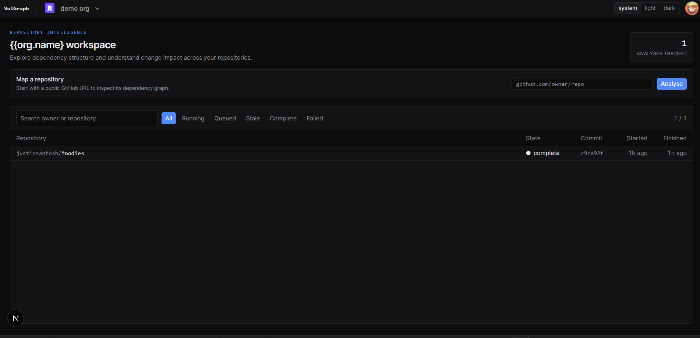
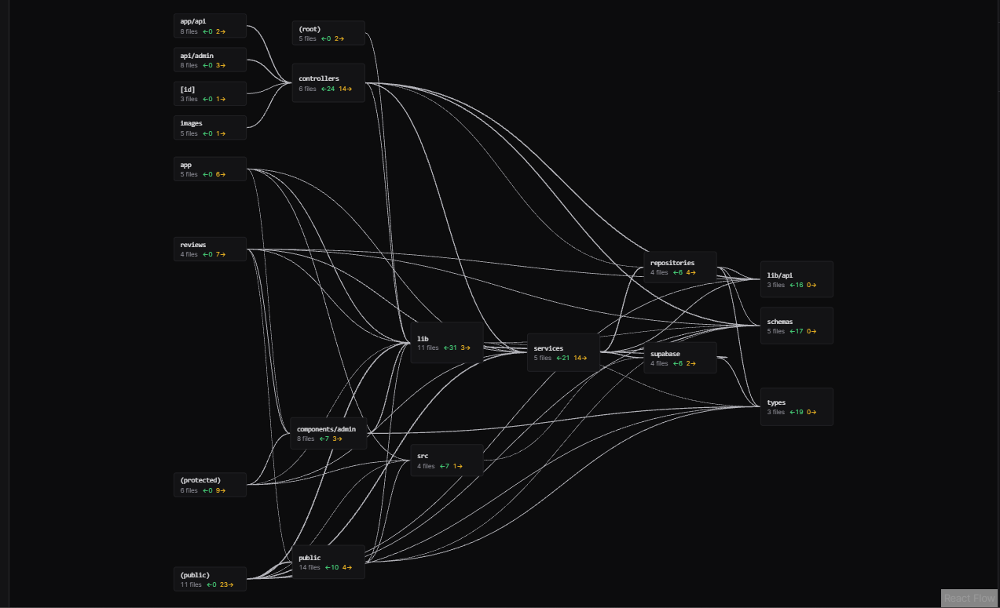
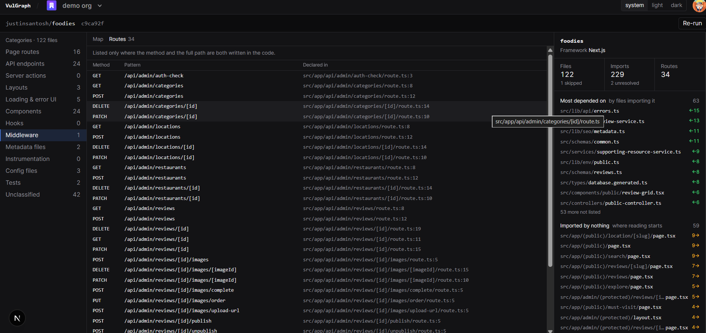
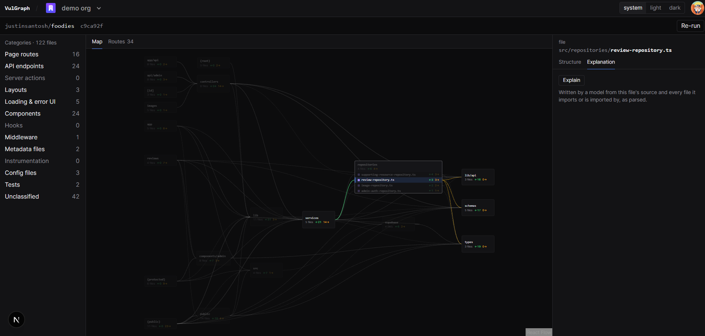

# VulGraph

VulGraph maps the dependencies in public JavaScript and TypeScript repositories. It parses source code into an interactive graph so developers can inspect module relationships, routes, and change impact.

> **Project origin:** VulGraph is a customized derivative of [Cartograph](https://github.com/adrianhajdin/cartograph) by JavaScript Mastery. The application and repository history retain their original contributors; this README documents VulGraph-specific changes and setup.

## Screenshots

### Workspace



### Dependency graph



### Repository routes



### File inspector



## What it does

- Parses JavaScript and TypeScript imports and builds a dependency graph from source files.
- Shows repository structure, routes, and module relationships in an interactive workspace.
- Computes dependency impact from the parsed graph.
- Provides AI explanations grounded in the selected file and its graph context.
- Uses Clerk organizations and Supabase row-level security to scope workspace data.
- Includes a separate Deep Agent service in `deep-agent/` for repository questions.

## Stack

Next.js 16, React 19, TypeScript, ts-morph, React Flow, Clerk, Supabase, OpenAI SDK, LangSmith, and Deep Agents.

## Run locally

### Requirements

- Node.js 20 or newer
- pnpm 10
- Clerk, Supabase, and OpenAI credentials for the features that use those services

### Install and configure

```bash
git clone https://github.com/JustinSantosh/VulGraph.git
cd VulGraph
pnpm install
Copy-Item .env.example .env.local # PowerShell
```

Fill in the values in `.env.local`:

```env
NEXT_PUBLIC_CLERK_SIGN_IN_URL=/sign-in
NEXT_PUBLIC_CLERK_SIGN_UP_URL=/sign-up
NEXT_PUBLIC_CLERK_SIGN_IN_FALLBACK_REDIRECT_URL=/
NEXT_PUBLIC_CLERK_SIGN_UP_FALLBACK_REDIRECT_URL=/
NEXT_PUBLIC_CLERK_PUBLISHABLE_KEY=
CLERK_SECRET_KEY=

NEXT_PUBLIC_SUPABASE_URL=
NEXT_PUBLIC_SUPABASE_PUBLISHABLE_KEY=
SUPABASE_SECRET_KEY=

LANGSMITH_TRACING=true
LANGSMITH_API_KEY=
LANGSMITH_PROJECT=vulgraph
LANGSMITH_ENDPOINT=https://api.smith.langchain.com

OPENAI_API_KEY=
AGENT_URL=http://localhost:2024
```

Never commit `.env.local` or service credentials. Apply the SQL migrations under `supabase/migrations/` to your Supabase project and configure Clerk's Supabase JWT integration for organization-scoped access.

### Start the web application

```bash
pnpm dev
```

Open [http://localhost:3000](http://localhost:3000).

### Start the Deep Agent service

In a second terminal:

```bash
cd deep-agent
Copy-Item .env.example .env # PowerShell
npm install
npm start
```

Set `GOOGLE_API_KEY` in `deep-agent/.env` to enable the Gemini-backed agent service.

## Project history and attribution

VulGraph is developed in the `JustinSantosh/VulGraph` repository. Its Git history includes upstream Cartograph commits, and the project has been customized for VulGraph with workspace, authentication, data-access, and agent-service changes. See the [upstream project](https://github.com/adrianhajdin/cartograph) for its original context and contributors.
